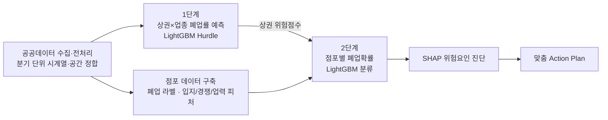

# 폐업 전에 진단하고 처방하다: 소상공인 폐업 조기경보 시스템

서울시 소상공인 점포가 **다음 분기에 폐업할 확률**을 예측하고, 위험을 키운 원인과 그에 맞는 금융 지원 방안까지 제시하는 2단계 하이브리드 위험 스코어링 시스템입니다.

> KB AI Challenge 참가를 계기로 3인 팀이 진행한 프로젝트입니다.

## 왜 만들었나

기존 소상공인 지원은 이용할 수 있는 정책자금을 안내하는 사후 대응에 머물러 있어서, 위험을 먼저 알아채고 지원을 요청하는 일은 사장님 개인의 판단에 맡겨져 있었습니다. 또 위험의 수준과 원인이 점포마다 다른데도 이를 정량적으로 진단해 자금·컨설팅·마케팅 지원으로 연결하는 체계가 없었습니다.

이 프로젝트는 공개 데이터만으로 **위험을 먼저 감지하고(진단)**, **원인에 맞는 지원을 연결하는(처방)** 조기경보 체계를 목표로 했습니다.

## 접근 방법

개별 점포의 매출 데이터는 공개되지 않고, 공개 데이터는 상권 단위로만 제공됩니다. 그래서 금융권 신용평가처럼 **거시(상권) 위험을 먼저 예측한 뒤, 이를 점포 단위 특성과 결합해 개인화**하는 2단계 구조를 설계했습니다.



### 1단계: 상권 × 업종 폐업 위험 예측

상권 × 업종 × 분기 단위로 **다음 분기 폐업률**을 예측합니다.

- **데이터**: 서울시 상권분석서비스 7종(점포, 추정매출, 소비, 길단위인구, 상주인구, 직장인구, 집객시설), 2021Q1~2025Q4, 약 144만 행
- **결측 처리**: 매출 결측을 원인별로 나눴습니다(매출 비제공 업종 / 표본 부족 비공개 / 정상). 점포 수가 0~1개인 상권은 매출 결측률이 75.7%에 달해 표본 부족에 따른 비공개로 판단했고, 값을 대체하지 않고 결측 유형 변수로 만들어 모델이 결측 자체를 학습하게 했습니다.
- **이상치**: 집계 시점 차이로 폐업률이 100%를 넘는 행(0.05%)을 제거했습니다.
- **피처 103개**: 점포·업종, 매출, 소비, 유동/상주/직장인구 원본 변수에 시계열 파생(lag, 전분기 대비 변화율, 4분기 평균 대비), 과거 폐업 이력, 교차 지표를 더했습니다.
- **모델(Hurdle 구조)**: 폐업률은 0이 대부분이라 두 모델로 나눴습니다.
  - Stage A (분류): 다음 분기에 폐업이 **발생할지** 예측, 확률 $p$
  - Stage B (회귀, Huber loss): 폐업이 발생했을 때 **얼마나** 일어날지 예측, 크기 $r$
  - 최종 예상 폐업률 $= p \times r$
- **검증**: 미래 데이터를 학습에 쓰지 않도록 2022Q1~2024Q4의 12개 분기를 Walk-Forward 방식으로 하나씩 예측했고, 각 fold 안에서도 최근 2개 분기를 내부 검증에 썼습니다. 5개 seed 앙상블로 결과를 안정화했습니다.

### 2단계: 개별 점포 폐업 확률

1단계 위험점수를 점포 특성과 결합해 점포 × 분기 단위의 다음 분기 폐업 확률을 예측합니다.

- **데이터**: 소상공인시장진흥공단 상가(상권)정보 15개 분기(2022Q1~2025Q3, 약 819만 행), 서울시 업종별 인허가 정보 8종(일반·휴게음식점, 미용업, 이용업, 담배소매업, 의원, 종합체육시설, 통신판매업)
- **폐업 라벨 생성**: 상가업소번호 집합을 분기마다 비교(t → t+1)해 사라진 점포를 찾고, 오탐을 두 단계로 걸렀습니다.
  - 상호명 + 업종 + 건물관리번호가 같은 점포가 다른 곳에 나타나면 **이전**으로 분류
  - t+2 분기에 다시 나타나면 일시적 누락(**데이터 갭**)으로 되돌림
  - 결과: 폐업 328,021건(4.29%), 이전 추정 40,666건, 데이터 갭 보정 14,611건
- **인허가 데이터로 라벨 보정**: 좌표계를 통일하고 RapidFuzz 상호명 유사도로 상가 데이터와 인허가 데이터를 A~D 등급으로 매칭했습니다. 매칭된 점포는 인허가 폐업일자와 영업상태로 라벨을 다시 계산해 18,365건을 생존으로, 7,697건을 폐업으로 고쳤습니다(원본 라벨은 따로 보존).
- **전처리**: 층정보를 순수 숫자로 해석하면 -307층~8,247층처럼 비현실적인 값이 나왔습니다. 원인은 '층+호' 압축 표기(예: 1502 = 15층 02호)였고, 이를 분리해 -9층~86층 범위로 정상화했습니다.
- **1단계 점수 결합**: 점포 좌표를 서울시 상권 폴리곤에 공간 조인(직접 매칭, 100m 이내 최근접 매칭)하고, 상가 업종 247개를 상권분석서비스 업종 100개로 연결하는 크로스워크를 만들었습니다. 매칭에 실패하면 상권 중앙값, 분기 중앙값 순으로 단계적으로 대체했습니다.
- **피처 49개**: 건물·입지(지상1층, 지하 여부 등), 건물 내 업종 구성(업소 수, 업종 다양성 entropy), 반경 100m/250m 이웃 수와 업종 다양성, 1단계 위험점수와 그 변화량, 업력, 인허가 매칭 등급, 업종 직전 분기 폐업률(shrinkage k=50) 등
- **모델**: LightGBM Classifier(`class_weight='balanced'`), 2024Q1~Q4 Walk-Forward 검증, Isotonic Calibration으로 확률 보정

### 3단계: 진단과 처방 (Action Plan)

| 단계 | 내용 |
|---|---|
| Risk Tier | 분기마다 확률 분포가 바뀌므로 고정 임계값 대신 분위수로 등급화: Critical(상위 5%), High(5~15%), Medium(15~30%), Low |
| 위험요인 진단 | SHAP 기여도를 6개 카테고리(상권쇠퇴, 업종구조위험, 건물내경쟁밀집, 반경경쟁밀집, 입지특성, 업력신생리스크)로 묶음. 위험군 전체에 공통으로 나타나는 **배경위험**과 이 점포만의 **대응근거**를 구분(점포 내 양수 기여도의 12% 이상이면서 위험군 SHAP 중앙값 이상인 요인만 대응근거로 채택) |
| 초과취약도 | 점포 폐업확률 − 같은 상권·업종의 평균 위험도. +10%p 이상이면 가게 자체 문제, −5%p 이하면 상권 자체가 어려운 상황으로 해석 |
| 맞춤 Action | 대응근거 카테고리별 기본 지원(대출·보증·컨설팅)을 매칭하고, 초과취약도에 따라 보정 문구를 추가 |

출력 예시는 [`action_plan_representative_cases.csv`](pipeline/result/action_plan/action_plan_representative_cases.csv)에 있습니다.

## 결과

| 모델 | 검증 방식 | ROC-AUC | 기타 |
|---|---|---|---|
| 1단계 (상권×업종) | Walk-Forward 12 fold (2022Q1~2024Q4) | **0.865** (0.854~0.875) | PR-AUC 0.50, Recall 0.87 |
| 2단계 (개별 점포) | Walk-Forward 4 fold (2024Q1~Q4) | **0.655** | Brier score 0.173 → **0.042** (Isotonic Calibration) |
| 2단계 (개별 점포) | 2025Q1~Q3 홀드아웃 | **0.607** | Brier score 0.032 |

1단계는 상권 단위 데이터가 풍부해 높은 판별력을 보였습니다. 2단계는 점포 매출, 대출·연체 같은 금융 정보, 임대료 등 실제 영업 상황을 공개 데이터로 얻을 수 없어 판별력에 한계가 있었습니다. 대신 확률 보정으로 예측 확률의 신뢰도를 크게 높여, 위험 순위와 등급 산정에 쓸 수 있는 수준으로 만들었습니다. 금융기관 내부 데이터와 연계하면 개선될 여지가 큰 부분입니다.

2025 홀드아웃은 학습에 전혀 쓰지 않은 미래 분기로 검증한 결과입니다. 2025Q1은 1단계 위험점수가 없는 구간이라 이 점을 감안해 해석해야 합니다.

## 폴더 구조

```
closure-early-warning/
├── pipeline/                         # 전체 파이프라인 (이 폴더에서 실행)
│   ├── main.ipynb                    # 아래 노트북을 순서대로 실행하는 러너
│   ├── step1_preprocessing.ipynb     # 1단계 데이터 병합·결측 처리·타깃 생성
│   ├── step1_model.ipynb             # 1단계 Hurdle 모델 학습, 상권 위험점수 테이블 생성
│   ├── merged_preprocessing.ipynb    # 상가업소 통합, 폐업 라벨 생성, 인허가 병합
│   ├── step2_preprocessing.ipynb     # 결측·상관관계 정리, 1단계 점수 공간 조인
│   ├── step2_model.ipynb             # 라벨 보정, 피처 생성, 2단계 LightGBM 학습
│   ├── action_plan.ipynb             # Risk Tier, SHAP 진단, 초과취약도, 추천 Action
│   ├── data/                         # 원본·중간 데이터 (git 제외)
│   └── result/
│       ├── step1_model/              # fold별 성능 요약
│       ├── step2_model/              # walk-forward 지표, 학습된 모델(saved_models_v6)
│       └── action_plan/              # 대표 진단 사례
├── validation_2025/                  # 2025 홀드아웃 검증 (Google Colab에서 실행)
├── requirements.txt
└── .gitignore
```

## 실행 방법

1. 패키지 설치: `pip install -r requirements.txt`
   - 저장된 모델(pkl)과 호환되려면 scikit-learn **1.5.2**가 필요합니다.
2. [`pipeline/data/README.md`](pipeline/data/README.md)를 참고해 원본 데이터를 `pipeline/data/`에 받아 둡니다.
3. `pipeline/` 폴더에서 `main.ipynb`를 실행합니다. `RUN_MODE`로 전체 파이프라인과 모델·Action Plan만 실행하는 모드를 고를 수 있습니다.

원본 데이터, 중간 산출물, 대용량 결과(OOF 예측, 위험점수 테이블 등), 1단계 fold별 모델은 용량 때문에 저장소에 포함하지 않았습니다. 모두 파이프라인을 실행하면 다시 생성됩니다.

## 기술 스택

Python · pandas · LightGBM · scikit-learn · SHAP · GeoPandas · RapidFuzz · matplotlib
